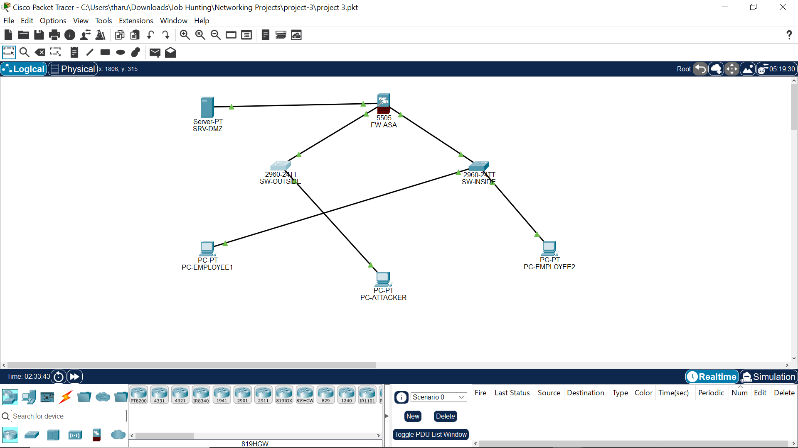

# Cisco ASA Firewall & DMZ Security Lab

A hands-on network security lab built in **Cisco Packet Tracer**. I designed a three-zone network (inside, DMZ, outside) around a **Cisco ASA 5505** firewall, published a web server in the DMZ, restricted outside access with a host-specific ACL, and hardened the access switches with **port security**.



## Why I built this

I'm building my foundation in cloud, DevOps and security, and I wanted to understand how traffic is actually separated and controlled at the network layer before it reaches any application. This lab covers three ideas:

- **Segmentation:** keeping untrusted, semi-trusted and trusted networks apart
- **Least privilege:** allowing only what is needed instead of opening whole subnets
- **Layer 2 hardening:** limiting which devices can plug into a switch port

## Topology

| Device | Role |
|---|---|
| `FW-ASA` | Cisco ASA 5505 (ASA 8.4(2)), the firewall between all three zones |
| `SW-OUTSIDE` | Cisco 2960 switch on the outside network |
| `SW-INSIDE` | Cisco 2960 switch for employee devices |
| `PC-ATTACKER` | Outside test host that simulates an external user |
| `PC-EMPLOYEE1`, `PC-EMPLOYEE2` | Inside employee endpoints |
| `SRV-DMZ` | Web server in the DMZ |

## Addressing plan

| Device / interface | IP address | Gateway |
|---|---|---|
| ASA outside (Vlan2) | `203.0.113.1/24` | n/a |
| PC-ATTACKER | `203.0.113.10/24` | `203.0.113.1` |
| ASA inside (Vlan1) | `192.168.10.1/24` | n/a |
| PC-EMPLOYEE1 | `192.168.10.10/24` | `192.168.10.1` |
| PC-EMPLOYEE2 | `192.168.10.11/24` | `192.168.10.1` |
| ASA DMZ (Vlan3) | `192.168.20.1/24` | n/a |
| SRV-DMZ | `192.168.20.10/24` | `192.168.20.1` |

The `203.0.113.0/24` range is reserved for documentation and examples, so I used it as a safe simulated "internet".

## Security design

### Firewall zones

| ASA VLAN | Zone name | Security level | Subnet |
|---|---|---:|---|
| Vlan1 | `inside` | 100 | `192.168.10.0/24` |
| Vlan3 | `dmz` | 50 | `192.168.20.0/24` |
| Vlan2 | `outside` | 0 | `203.0.113.0/24` |

Traffic flows freely from higher to lower security levels. Traffic from lower to higher is denied unless an ACL permits it. The ASA 5505 on this license requires `no forward interface Vlan1` on the DMZ interface, which stops the DMZ from initiating connections to the inside network.

### Outside access control list

```
access-list OUTSIDE-IN extended permit tcp host 203.0.113.10 host 192.168.20.10 eq www
access-list OUTSIDE-IN extended permit icmp host 203.0.113.10 host 192.168.20.10
access-group OUTSIDE-IN in interface outside
```

- Only one outside host (`203.0.113.10`) is allowed through.
- It can reach only one destination (the DMZ web server) and only over HTTP, plus ICMP for troubleshooting.
- Nothing from the outside is permitted to the employee network.

### Switch port security

Applied to the employee access ports on `SW-INSIDE` (Fa0/1, Fa0/2) and the attacker port on `SW-OUTSIDE` (Fa0/1):

```
switchport mode access
switchport port-security
switchport port-security maximum 1
switchport port-security violation restrict
switchport port-security mac-address sticky
```

Each port learns the first device's MAC address and accepts only that device. If a different device is plugged in, its frames are dropped and a violation is logged, but the port stays up.

## Test results

| Test | Result |
|---|---|
| Employee-to-employee ping (`PC-EMPLOYEE1` to `PC-EMPLOYEE2`) | Succeeded |
| Outside host pinging an employee PC (`203.0.113.10` to `192.168.10.10`) | Timed out, so the inside network is not reachable from outside |
| Port security status on inside ports | Secure-up, one sticky MAC learned, zero violations at capture time |
| HTTP service on `SRV-DMZ` | Enabled |
| Outside host browsing to `http://192.168.20.10` | Worked in one test run but was inconsistent in later runs |

The HTTP result is the one I'm least happy with. Packet Tracer's ASA simulation can behave inconsistently, so I'm recording what I observed rather than claiming it is repeatable. A timeout also doesn't tell me exactly which control dropped the packet, since the ASA's default behavior denies lower-to-higher traffic anyway. I'd confirm that with ACL hit counters before and after each test.

## Screenshots

| File | Shows |
|---|---|
| [`01-topology.png`](screenshots/01-topology.png) | Network layout and zones |
| [`02-asa-interface-status.png`](screenshots/02-asa-interface-status.png) | ASA interface status |
| [`03-asa-configuration.png`](screenshots/03-asa-configuration.png) | ASA interface and ACL configuration |
| [`04-attacker-blocked-from-inside.png`](screenshots/04-attacker-blocked-from-inside.png) | Outside host's ping to the inside network timing out |
| [`05-inside-switch-port-security.png`](screenshots/05-inside-switch-port-security.png) | Port-security status on the inside switch |
| [`06-attacker-ping-test.png`](screenshots/06-attacker-ping-test.png) | Attacker ping test in the command prompt |
| [`07-dmz-http-service.png`](screenshots/07-dmz-http-service.png) | HTTP service enabled on the DMZ server |
| [`08-topology-validation.png`](screenshots/08-topology-validation.png) | Additional topology and test context |
| [`09-http-browser-test.png`](screenshots/09-http-browser-test.png) | Browser test against the DMZ server |

## How to reproduce

The Packet Tracer project file is not included. The addressing plan, configs and screenshots in this repo contain everything needed to rebuild the lab.

1. Rebuild the topology in Cisco Packet Tracer using the diagram in `screenshots/01-topology.png` (one ASA 5505, two 2960 switches, two employee PCs, one attacker PC and one server).
2. Check the IP addresses and gateways against the addressing plan above.
3. On `SRV-DMZ`, go to **Services > HTTP** and make sure HTTP is on.
4. On `FW-ASA`, apply the configs from `configs/` and run:
   ```
   show interface ip brief
   show running-config
   show access-list
   ```
5. On both switches, apply the port-security configs and run:
   ```
   show port-security
   show port-security address
   ```
6. From `PC-EMPLOYEE1`, run `ping 192.168.10.11`.
7. From `PC-ATTACKER`, run `ping 192.168.10.10` (expect a timeout), then open `http://192.168.20.10` in the browser.
8. Run `show access-list` before and after step 7 and compare the hit counters.

## Repository structure

```
.
├── README.md
├── configs/
│   ├── asa-acl.txt
│   ├── asa-interface-summary.txt
│   ├── inside-switch-port-security.txt
│   └── outside-switch-port-security.txt
└── screenshots/
```

## Limitations and next steps

This is a learning lab in a simulator, not a production design. It uses a single firewall, one permitted outside host and no logging or alerting.

What I plan to improve next:
- Repeat the HTTP test several times and record ACL hit counters for each run
- Add logging on the ASA so denied traffic is visible
- Add an explicit deny rule and test it

## Skills demonstrated

Network segmentation · Cisco ASA firewall configuration · Access control lists · DMZ design · Switch port security · Network troubleshooting · Technical documentation

## Author

**Tharun Kumaran M**
[LinkedIn](https://www.linkedin.com/in/tharunkumaran11) · [GitHub](https://github.com/tharunkumaran11)
